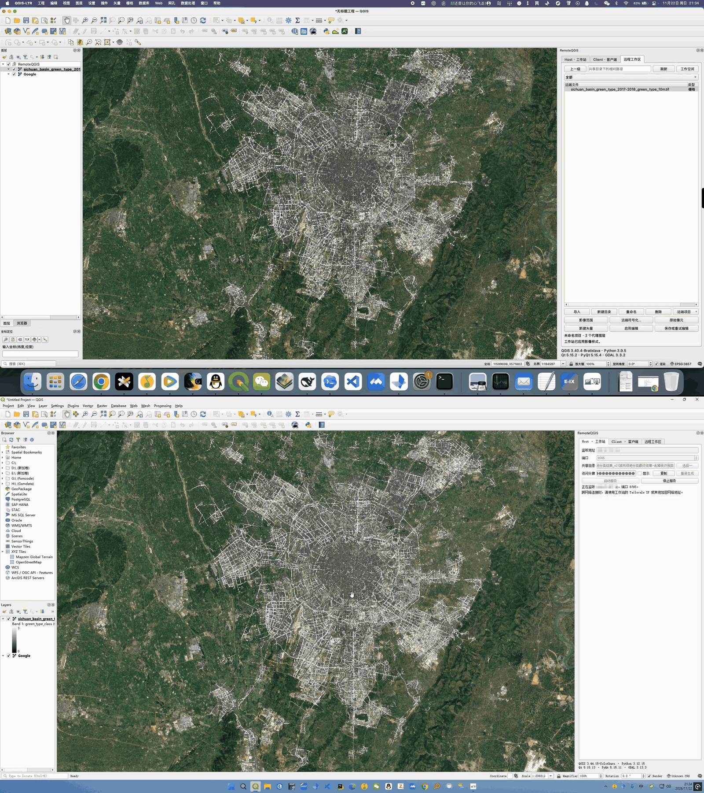

# RemoteQGIS

[English](README.md) | [简体中文](README.zh-CN.md)

RemoteQGIS is a remote GIS workspace plugin for QGIS Desktop 3.x. The workstation keeps the real datasets and the main QGIS project, while the client browses shared directories, configures raster and vector styling, manages projects, edits vector layers and runs workstation-side algorithms from its local QGIS. The plugin ZIP contains both Host and Client modes.

## Downloads

Only version 1.2.0 is provided. Installers are published on [GitHub Releases](https://github.com/wqlin08/RemoteQGIS/releases):

- `RemoteQGIS-1.2.0.zip`: QGIS plugin ZIP for both ends.
- `RemoteQGIS-Host-Manager-macOS-1.2.0.zip`: macOS workstation manager.
- `RemoteQGIS-Host-Manager-Windows-x64-1.2.0-Setup.exe`: Windows workstation installer.

## Host Manager

The workstation can run the standalone Host Manager, which keeps the management service in the system tray after login. When a client connects, the workstation opens QGIS Desktop and starts the RemoteQGIS Host inside it. The client can switch between the pre-authorized workspace directories and their subdirectories.

## Manual two-end QGIS Desktop connection

1. On both computers, use QGIS 3.40 or a newer 3.x release. Open **Plugins → Manage and Install Plugins → Install from ZIP** and select the same `RemoteQGIS-1.2.0.zip`.
2. On the workstation, open **Plugins → RemoteQGIS → Host · 工作站**, choose the shared directory, and start the service. For remote access, set the listening address to the workstation's Tailscale IP; the default port is `8765`. Give the access token to the client.
3. On the client, open **Client · 客户端**, enter the workstation address, port and token, then click **直接连接 GIS**. After authentication, switch to the remote workspace.
4. Two local QGIS sessions can use `127.0.0.1` for a local test. Keep HTTPS / WSS disabled when connecting directly over Tailscale, which already encrypts the transport. Enable it only behind a TLS reverse proxy with a valid certificate.

The default listener is loopback-only. The workstation UI can stop the listener. Tokens are kept only for the current QGIS session.

## Remote workspace

Open GeoTIFF, GeoPackage and Shapefile files in the shared directory by double-clicking, multi-selecting or dragging them onto the map canvas. The workstation renders transparent tiles from the raster style; the client displays the GeoTIFF through those tiles. With a raster selected, use **远端符号化…** to edit a class palette, single-band pseudocolor, gray stretch, RGB, resampling and opacity, or apply a local QGIS raster QML style. The client refreshes the visible tiles after applying the style to the workstation layer; saving the remote project preserves the layer style.

**影像范围** zooms to the native raster extent. **原始像元** and the RemoteQGIS workstation Processing toolbox both read the real raster data through the workstation.

Inside the **RemoteQGIS** group in the client layer tree, native QGIS controls can reorder, group, hide, rename and adjust vector opacity, symbols and labels. Use the **远端项目** menu to open, create, save or save-as remote `.qgz` / `.qgs` projects. Deleting shared files requires confirmation and then moves them to `.remoteqgis-trash` under the workstation shared directory.

After selecting an existing vector layer, click **启用编辑** and confirm adding the plugin-managed `rq_uuid` field. A new vector layer can specify its directory, file type, geometry type, CRS and fields. Native QGIS digitizing, snapping, node and attribute tools then work locally. Right-click to finish a polygon; layers with only the internal identifier can complete drawing directly. Use **保存图层编辑** or **保存或重试编辑** to submit changes. Until the workstation confirms them, the client keeps a recovery record under `remoteqgis/pending` in the current QGIS user profile; submission resumes automatically after reconnection.

## Remote analysis and online layers

Expand **RemoteQGIS 工作站** in the QGIS Processing Toolbox. Select a proxy layer imported from the shared directory and enter an output path relative to the workstation shared directory. The algorithm runs on the workstation; the result is saved to that path and added to both projects.

Add online XYZ, WMS or WMTS layers in the usual QGIS way. They initially stay outside the **RemoteQGIS** group. To display the same layer on the other side, drag it into the group; the workstation loads the same online service. Local files, memory layers, authenticated sources and unsupported online sources are moved back outside the group with an explanation.

RemoteQGIS is released under GPL-3.0-or-later. The bundled Tornado sources in the plugin ZIP remain under Apache-2.0.
