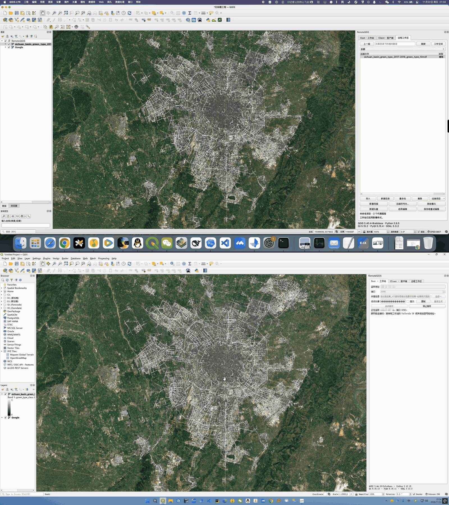

# RemoteQGIS

[English](README.md) | 简体中文

RemoteQGIS 是面向 QGIS Desktop 3.x 的远程 GIS 工作空间插件。工作站保存真实数据和 QGIS 主项目；客户端在本机 QGIS 中浏览共享目录、配置栅格和矢量样式、管理项目、编辑矢量并运行工作站算法。插件 ZIP 同时包含 Host 与 Client 模式。

## 下载

仅提供 1.2.0 版本，安装包位于 [GitHub Releases](https://github.com/wqlin08/RemoteQGIS/releases)：

- `RemoteQGIS-1.2.0.zip`：QGIS 插件 ZIP，两端安装同一份文件。
- `RemoteQGIS-Host-Manager-macOS-1.2.0.zip`：macOS 工作站管理程序。
- `RemoteQGIS-Host-Manager-Windows-x64-1.2.0-Setup.exe`：Windows 工作站单文件安装程序。

## Host Manager

工作站可安装独立的 Host Manager，登录后可在托盘运行管理服务。客户端连接时，工作站打开 QGIS Desktop 并启动其中的 RemoteQGIS Host。客户端可在工作站预先授权的多个目录及其子目录之间切换工作空间。

## 双端 QGIS Desktop 手动连接

1. 在两台设备的 QGIS 3.40 或更新的 3.x 版本中，进入「插件 → 管理并安装插件 → 从 ZIP 安装」，选择同一份 `RemoteQGIS-1.2.0.zip`。
2. 在工作站打开「插件 → RemoteQGIS → Host · 工作站」，选择共享目录。跨网络使用时，将监听地址改为工作站的 Tailscale IP，端口默认是 `8765`。启动服务后，将访问令牌提供给客户端。
3. 在客户端选择 **Client · 客户端**，填写工作站的 IP 或主机名、端口和令牌，点击「直接连接 GIS」。认证成功后切换到 **远程工作区**。
4. 两个本机 QGIS 会话可用 `127.0.0.1` 试用。通过 Tailscale IP 直连时保持 HTTPS / WSS 关闭，由 Tailscale 隧道提供传输加密；使用配置了有效证书的 TLS 反向代理时，启用 HTTPS / WSS。

默认监听回环地址。工作站界面可停止监听。令牌仅保留在本次 QGIS 会话中。

## 远程工作区

在共享目录内通过双击、多选导入或将文件拖到地图画布来打开 GeoTIFF、GeoPackage 和 Shapefile。工作站用 QGIS 根据栅格样式生成带透明度的瓦片，客户端用瓦片显示 GeoTIFF。选中栅格后，点击「远端符号化…」可修改类别色表、单波段伪彩色、灰度拉伸、RGB、重采样和不透明度，也可应用本机的 QGIS 栅格 QML 样式。设置应用到工作站图层后，客户端刷新当前视野的瓦片；保存远端项目可保留图层样式。

「影像范围」缩放到原始范围。「原始像元」和 RemoteQGIS 工作站处理工具箱均通过工作站读取真实栅格数据。

在客户端 QGIS 图层树的 **RemoteQGIS** 分组内，可以用原生界面排列、分组、隐藏、重命名、调整矢量透明度、符号和标注。通过插件中的「远端项目」菜单打开、创建、保存或另存远端 `.qgz` / `.qgs`。删除共享文件需确认，随后文件移入工作站共享目录下的 `.remoteqgis-trash`。

已有矢量选中后点击「启用编辑」，确认在数据中增加由插件管理的 `rq_uuid` 字段。新建矢量可指定保存目录、文件类型、几何类型、坐标系和字段。启用后可在本机使用 QGIS 原生数字化、捕捉、节点和属性工具。绘制面后右键结束，只有内部标识的图层会直接完成绘制。使用「保存图层编辑」或「保存或重试编辑」提交到工作站。工作站确认前，客户端在当前 QGIS 用户配置的 `remoteqgis/pending` 目录保留记录；连接恢复后可自动提交。

## 远程分析与在线图层

在 QGIS「处理工具箱」展开 **RemoteQGIS 工作站**。选择共享目录导入的代理图层，填写相对于工作站共享目录的输出路径。算法在工作站计算，结果保存到指定路径并同步加入双端项目。

先在客户端按 QGIS 的常规方式加入在线 XYZ、WMS 或 WMTS 图层。它默认位于 **RemoteQGIS** 分组外；希望对端也显示时，将这个图层拖入分组。工作站通过同一个在线服务加载图层。本地文件、内存图层、带凭据和暂未支持的在线源拖入时会恢复到分组外，并显示原因。

RemoteQGIS 源码以 GPL-3.0-or-later 发布。插件 ZIP 中的 Tornado 源码保留 Apache-2.0 许可。
